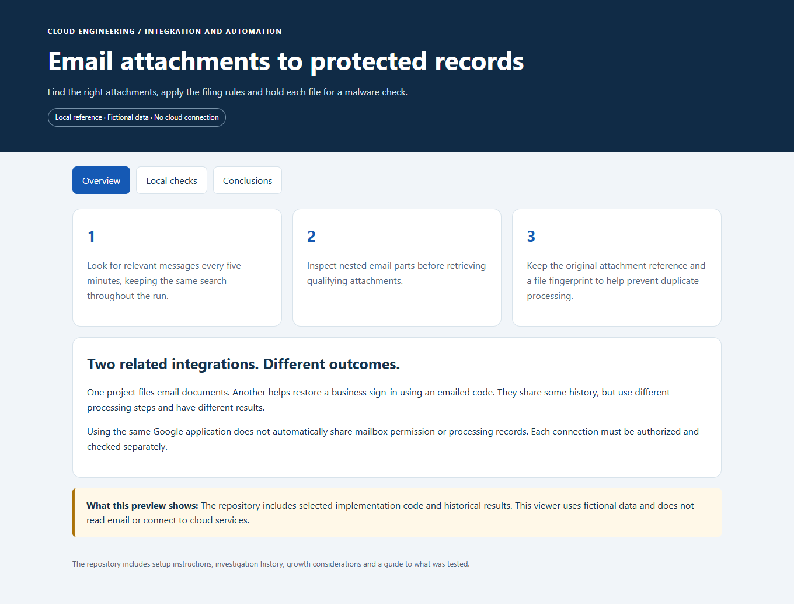
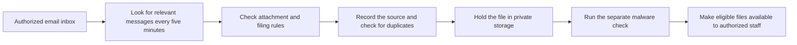
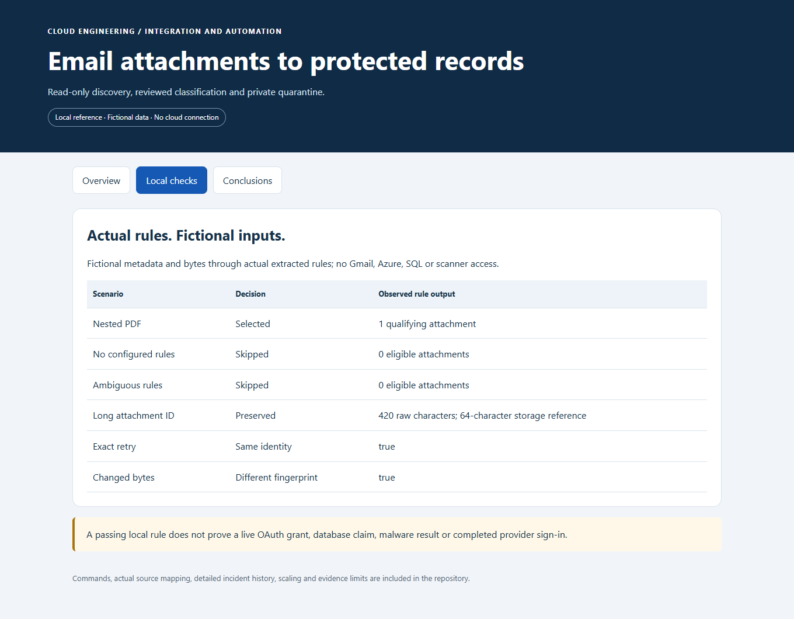
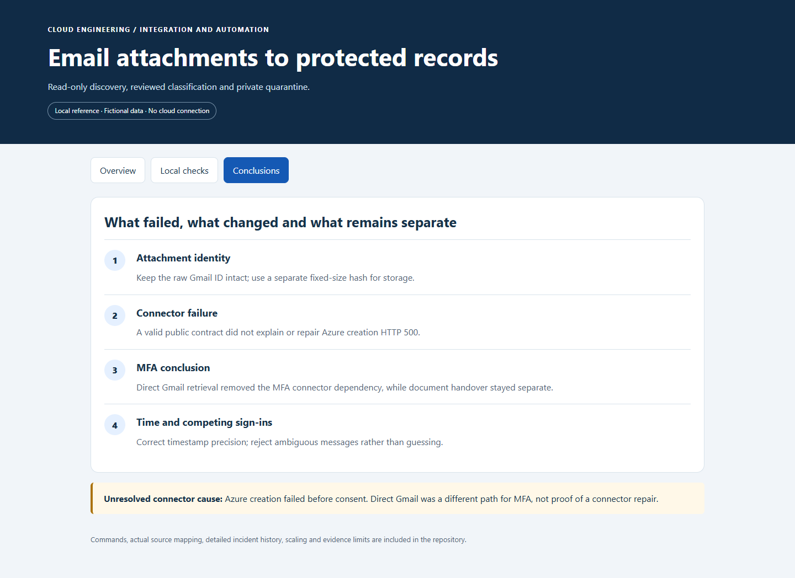

# Email Document Ingestion with Azure Logic Apps

**Automatically file selected email attachments and keep a record of where they came from.**

[Business problem](#the-business-problem) · [Solution](#the-solution) · [Build issues](#what-went-wrong-and-what-we-learned) · [Proof](#proof-it-works) · [Commands](docs/COMMANDS.md) · [Step by step](#step-by-step)



## The Business Problem

Important documents arrived as email attachments. Keeping them in an inbox made filing, retrieval and audit preparation harder. Downloading every attachment would also bring in unrelated, duplicate or unchecked files.

## The Solution

I used Azure Logic Apps, a service for connecting scheduled tasks, to look for relevant messages. The application checks the sender, filename and filing rules before retrieving an attachment.

Selected files go into private storage for a malware check. The application keeps their source details and checks for duplicates.

**Business outcome:** The implementation provides a repeatable filing process with a traceable source for each accepted document. The project also records a later connector replacement that remained blocked; it does not claim a completed mailbox migration.

## Tools Used and What They Do

| Tool or service | What it does | Where it fits |
| --- | --- | --- |
| Azure Logic Apps | Coordinate the original document-email workflow. | Actual integration design/history; replacement connector commissioning remained unresolved. |
| Gmail API and OAuth 2.0 | Read approved mailbox messages and authorize access. | Service API and authorization protocol; mailbox consent is a separate step. |
| Azure Key Vault | Protect integration credentials in the platform. | Actual secret boundary; no credentials are published. |
| Azure Functions, Node.js and TypeScript | Apply ingestion contracts and document-selection rules. | Selected source rules and local tests, not a completed mailbox migration. |
| Blob Storage, Defender for Storage and Event Grid | Hold incoming bytes and connect them to scanning. | Actual document pipeline boundary; discovery alone is not accepted ingestion. |
| Terraform and Python | Describe related resources and run the local reference view. | Reference tools; no connector or workflow is activated. |

The later direct Gmail MFA implementation reached a different conclusion and is a separate project. Its success did not repair the document connector or prove an ingestion handover.

## Step by Step

A short walkthrough of the process, with technical instructions and evidence limits in the sections below.

1. **Find relevant email messages (Logic Apps and Gmail API)** — The scheduled process looks for messages that may contain business documents. It keeps the same search while reading the results.

2. **Select the right attachments** — The application applies the configured sender, filename and filing rules. Attachments with missing or conflicting rules are not accepted automatically.

3. **Record and hold the file (Blob Storage)** — The application preserves the original message and attachment references and checks for duplicates. Selected files wait in private storage for a separate malware check.

4. **Confirm the processing path** — Check the file result and the records showing what was processed. The later connector replacement remained blocked, so this case study does not claim a completed replacement handover.

## Architecture



Permission to read Gmail is separate from permission to save documents in the application.

## What Was Built

| Part | What it does | Details |
| --- | --- | --- |
| Scheduled email search | Finds possible documents and handles multiple pages of results. | [Logic App definition](infra/logic-app/main.tf) |
| Filing rules | Selects attachments that match exactly one approved rule. | [Selection code](src/planner/inboundgmailmessageplan.ts) |
| File checks | Validates the submitted file and its identifying details. | [Upload checks](src/contracts/inboundDocumentIngestion.ts) |
| Processing records | Tracks the original message and attachment and distinguishes a retry from different content. | [Application code](reference/inbounddocumentingestion-route.ts) and [database](reference/037-inbound-document-ledger.sql) |
| Investigation history | Explains what was repaired and what remained unresolved. | [Issues and conclusions](docs/ISSUES-AND-CONCLUSIONS.md) |

## What Went Wrong and What We Learned

| Issue | What changed or remained unresolved |
| --- | --- |
| Some attachment identifiers were longer than expected. | The code now preserves the full identifier and uses a separate fixed-size reference for storage. |
| The email search could change while reading later pages. | The replacement code keeps one search for the whole run. A live replacement test was not completed. |
| A replacement connector failed during Azure resource creation. | Valid setup instructions did not resolve the service error. Its underlying cause remained unknown. |
| A later sign-in recovery effort hit the same connector problem. | Direct Gmail access became the separate recovery approach; it did not repair this document connector. |

[Read the investigation](docs/ISSUES-AND-CONCLUSIONS.md) or see the separate [Gmail recovery project](https://github.com/truthofsource/gmail-api-access-and-mfa-recovery).

## Proof It Works

**32 recorded local tests passed** using fictional messages. They checked attachment selection, conflicting rules, long identifiers and repeat-processing decisions. Two infrastructure test cases used simulated Azure responses.

These checks tested the included code and disabled setup example. They did not read a live mailbox or establish that the replacement connector worked. [Full results](docs/VALIDATION.md).

<details>
<summary>For engineers: detailed results, examples and commands</summary>

### 1. Run the extracted rules

```bash
npm test
npm run demo
```

**Observed: 32 local code tests passed, with zero failures.** Tests exercise real selected source with fictional inputs. The demonstration shows nested PDF selection, missing and ambiguous rules, a long attachment ID, repeat identity and changed-byte fingerprints. It does not connect to Gmail or save a document.



### 2. Inspect the historical conclusions



A planned activation, an authorized mailbox connection and a verified replacement are different milestones. The [status and evidence guide](docs/VALIDATION.md) keeps them separate. A successful empty poll does not prove document ingestion or complete coverage.

### 3. Validate the disabled workflow definition

```bash
terraform -chdir=infra/logic-app init -backend=false
terraform -chdir=infra/logic-app fmt -check -recursive
terraform -chdir=infra/logic-app validate
terraform -chdir=infra/logic-app test
python -B scripts/preview.py --port 8141
```

Open [the local reference](http://127.0.0.1:8141). The Terraform tests use simulated Azure responses. By default, the example creates no workflow; choosing to create it still leaves its execution disabled. No `apply` is required or performed.

</details>

## Strengths, Weaknesses and Tradeoffs

| Benefit | Limitation |
| --- | --- |
| Scheduled filing reduces the need to handle each matching attachment manually. | Connections, permissions and service costs still need maintenance. |
| Duplicate checks tolerate overlapping searches. | A longer outage needs a separate plan to find missed messages. |
| Files wait for a malware check. | A paused scanner or processing backlog can delay availability. |
| Source details support investigation and audits. | Matching a sender address alone does not establish that an email is genuine. |

As volume grows, measure processing delays and missed time ranges before increasing parallel work. Preserve duplicate protection when adding more workers. [Operations and growth](docs/OPERATIONS-AND-SCALING.md).

## Guides

- [Implementation and identity boundaries](docs/IMPLEMENTATION.md)
- [Issues, investigation and conclusions](docs/ISSUES-AND-CONCLUSIONS.md)
- [Commands and clickops](docs/COMMANDS.md)
- [Operations, costs and scaling](docs/OPERATIONS-AND-SCALING.md)
- [Source map](docs/SOURCE-MAP.md)
- [Validation and evidence limits](docs/VALIDATION.md)

Actual implementation source is included with fictional organization labels. Screenshots show a new local reference, not fresh Azure acceptance. No mailbox access, backfill, service start, message or deployment is performed to publish this project. GitHub checks are manual-only.
