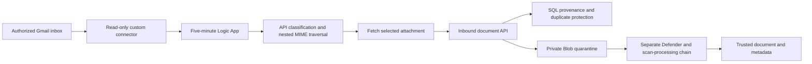

# Email Document Ingestion with Azure Logic Apps

**Move qualifying email attachments into protected business records without manually filing every message.**

[Business problem](#the-business-problem) · [Solution](#the-solution) · [Build issues](#what-went-wrong-and-what-we-learned) · [Proof](#proof-it-works) · [Commands](docs/COMMANDS.md)


## The Business Problem

Important authorization documents arrived as email attachments. Leaving them in an inbox made filing, retrieval and audit preparation harder. Automatically downloading everything would create a different problem: unrelated files, duplicates and unchecked documents entering business records.

## The Solution

Use a scheduled Consumption Logic App to find candidate messages through a read-only Gmail connector. Let an API inspect nested message parts and apply approved sender, filename and optional message-signal rules. Retrieve only qualifying attachments, preserve their origin and place the bytes in private quarantine for malware checking.

**Business outcome:** A repeatable filing path ties each accepted document to its source and rule version. Duplicate protection reduces repeat processing when polling windows overlap. This case study makes no unsupported time-saving or fully migrated-mailbox claim.

## Architecture



Gmail OAuth authorizes mailbox reads. The Logic App's managed identity authorizes calls to the application API. Those are separate permissions. The API requires an application role; its own authentication middleware handles access.

## What Was Built

| Component | Purpose | Included implementation |
| --- | --- | --- |
| Read-only Gmail contract | List messages, read a message and retrieve a selected attachment | [OpenAPI](contracts/gmail-readonly.openapi.json) |
| Actual steady workflow extraction | Five-minute recurrence, fixed search per run, pagination, protected action history and managed-identity API calls | [Terraform](infra/logic-app/main.tf) |
| Actual planner | Traverse nested MIME parts and select attachments with one matching configured rule | [Planner](src/planner/inboundgmailmessageplan.ts) |
| Actual contract and preparation | Validate bytes and metadata; preserve raw attachment IDs; calculate fingerprints and duplicate identity | [Contract](src/contracts/inboundDocumentIngestion.ts), [rules](src/documents/inboundDocumentRules.ts) |
| Actual integration reference | SQL ledger, replay/conflict handling and full route dependencies | [Route](reference/inbounddocumentingestion-route.ts), [SQL](reference/037-inbound-document-ledger.sql) |
| Historical conclusions | Distinguish original ingestion repairs from the later MFA connector attempt | [Issues and conclusions](docs/ISSUES-AND-CONCLUSIONS.md) |

## What Went Wrong and What We Learned

| Problem | Conclusion or correction |
| --- | --- |
| Gmail attachment IDs exceeded a 200-character assumption | Keep the original ID intact. Use a domain-separated hash when a fixed-size database reference is needed. |
| Successful historical Logic App runs did not expose the expected retained Response output | Inspect actual available evidence. Controlled metadata reacquisition replaced repeated attempts to fetch a missing output surface. |
| Recalculating a time-based search between pages moved the query boundary | The replacement source captures one query and reuses it on every page. That correction is source evidence, not live handover acceptance. |
| Replacement connector creation returned Azure HTTP 500 before OAuth | No confirmed connector root cause or successful replacement commissioning was established. Longer timeouts and valid OpenAPI alone were not a fix. |
| A later provider MFA effort encountered the connector problem too | Direct Gmail API access became the separate MFA solution. It did not repair or replace document ingestion. |

See [the linked Gmail access and MFA project](https://github.com/truthofsource/gmail-api-access-and-mfa-recovery) for that conclusion, OAuth lifecycle and the timestamp-precision repair.

## Proof It Works

### 1. Run the extracted rules

```bash
npm test
npm run demo
```

**Observed: 32 local code tests passed, with zero failures.** Tests exercise real selected source with fictional inputs. The demonstration shows nested PDF selection, missing and ambiguous rules, a long attachment ID, repeat identity and changed-byte fingerprints. It does not connect to Gmail or save a document.


### 2. Inspect the historical conclusions


Earlier prospective activation, a current authorized mailbox connection and a fully accepted replacement handover are different claims. The [status and evidence guide](docs/VALIDATION.md) keeps them separate. A successful empty poll does not prove document ingestion or complete coverage.

### 3. Validate the disabled workflow definition

```bash
terraform -chdir=infra/logic-app init -backend=false
terraform -chdir=infra/logic-app fmt -check -recursive
terraform -chdir=infra/logic-app validate
terraform -chdir=infra/logic-app test
python -B scripts/preview.py --port 8141
```

Open [the local reference](http://127.0.0.1:8141). Terraform uses simulated provider responses; the definition defaults absent, and even its enabled creation flag leaves the workflow disabled. No `apply` is required or performed.

## Strengths, Weaknesses and Tradeoffs

| Choice | Strength | Limitation |
| --- | --- | --- |
| Logic Apps orchestration | Makes schedules and processing steps visible | Connector provisioning, consent and per-action costs remain dependencies |
| Deterministic classification | Avoids treating every email attachment as a business record | Rule changes require review; a sender header alone is not cryptographic sender proof |
| Overlap plus duplicate identity | Helps tolerate repeated discovery | A 15-minute lookback is not a durable cursor or outage recovery |
| Private quarantine | Keeps received bytes untrusted until checked | Scanner backlog and event failures need independent monitoring |
| Original IDs plus hashes | Keeps retrieval and database identities consistent | Hashing must not replace the raw ID used for retrieval or replay identity |

## Guides

- [Implementation and identity boundaries](docs/IMPLEMENTATION.md)
- [Issues, investigation and conclusions](docs/ISSUES-AND-CONCLUSIONS.md)
- [Commands and clickops](docs/COMMANDS.md)
- [Operations, costs and scaling](docs/OPERATIONS-AND-SCALING.md)
- [Source map](docs/SOURCE-MAP.md)
- [Validation and evidence limits](docs/VALIDATION.md)

Actual implementation source is included with fictional organization labels. Screenshots show a new local reference, not fresh Azure acceptance. No mailbox access, backfill, service start, message or deployment is performed to publish this project. GitHub checks are manual-only.
