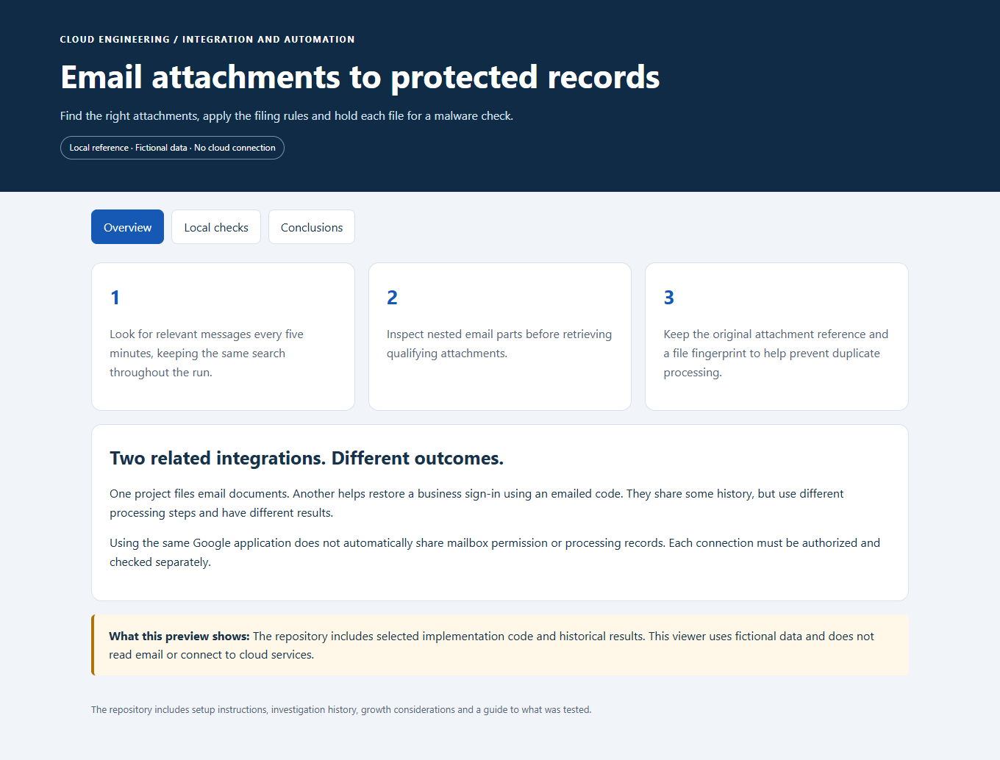
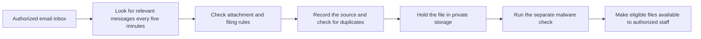
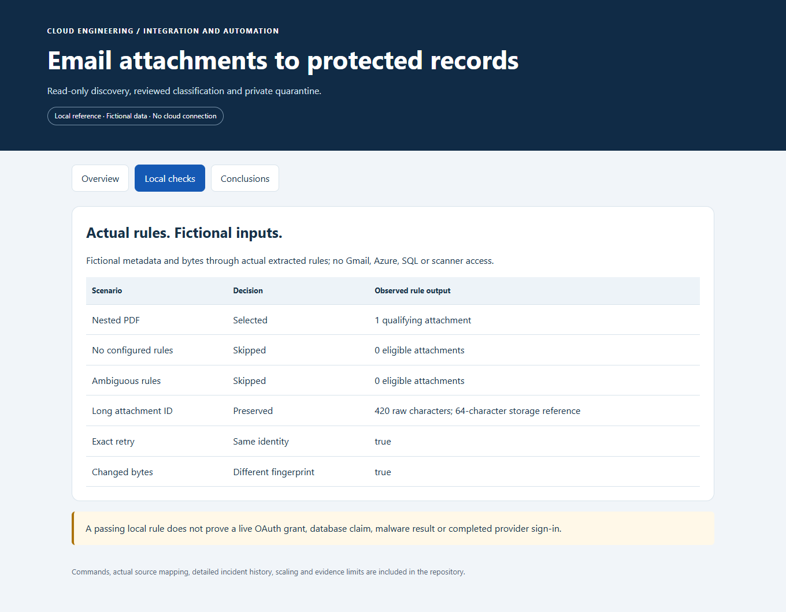
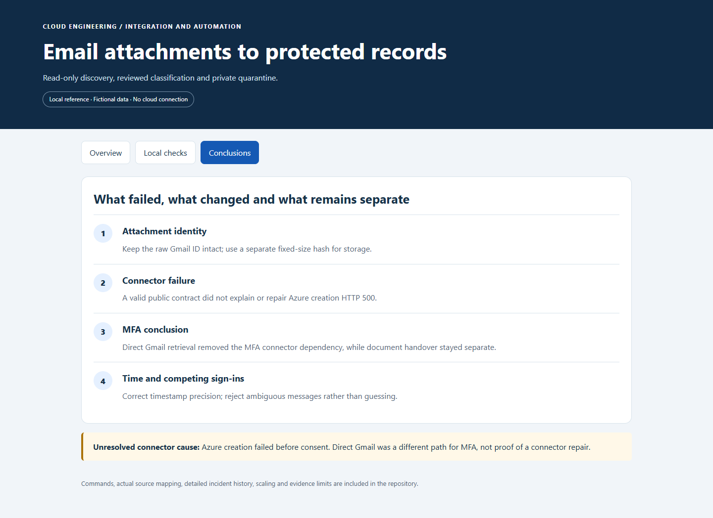

# Email Document Ingestion with Azure Logic Apps

**Automatically file selected email attachments and keep a record of where they came from.**

[Business problem](#the-business-problem) · [Solution](#the-solution) · [Build issues](#what-went-wrong-and-what-we-learned) · [Proof](#proof-it-works) · [Commands](docs/COMMANDS.md) · [Step by step](#step-by-step)



## The Business Problem

Business documents arriving as email attachments can remain scattered across messages and folders. Staff then have to locate the right email, identify the relevant attachment, download it and file it with enough context for later retrieval or audit preparation. Repeating that work becomes harder as the mailbox grows.

Copying every attachment introduces its own problems: unrelated files enter the document library, repeated messages create duplicate records and an attachment can be opened before its file check completes. The automation also depends on a working mailbox authorization and connector, so a configured process can still stop before filing anything.

The business need was selective, traceable document filing that preserves where each accepted file came from, handles duplicates and leaves connection failures visible for recovery.

## The Solution

I used Azure Logic Apps, a service for connecting scheduled tasks, to look for relevant messages. The application checks the sender, filename and filing rules before retrieving an attachment.

Selected files go into private storage for a malware check. The application keeps their source details and checks for duplicates.

**Business outcome:** The implementation provides a repeatable filing process with a traceable source for each accepted document. The project also records a later connector replacement that remained blocked; it does not claim a completed mailbox migration.

## Tools Used and What They Do

| Tool or service | What it does | Where it fits |
| --- | --- | --- |
| Azure Logic Apps | Coordinate the original document-email workflow. | Actual integration design/history; replacement connector commissioning remained unresolved. |
| Gmail API and OAuth 2.0 | Read approved mailbox messages and authorize access. | Service API and authorization protocol; mailbox consent is a separate step. |
| Azure Key Vault | Protect integration credentials in the platform. | Actual secret boundary; no credentials are published. |
| Azure Functions, Node.js and TypeScript | Apply ingestion contracts and document-selection rules. | Selected source rules and local tests, not a completed mailbox migration. |
| Blob Storage, Defender for Storage and Event Grid | Hold incoming bytes and connect them to scanning. | Actual document pipeline boundary; discovery alone is not accepted ingestion. |
| Terraform and Python | Describe related resources and run the local reference view. | Reference tools; no connector or workflow is activated. |

The later direct Gmail MFA implementation reached a different conclusion and is a separate project. Its success did not repair the document connector or prove an ingestion handover.

## Step by Step

Your own Logic App that reads approved email attachments into a private quarantine container, with a documented connector failure/fallback path.

[Open the standalone build guide](docs/BUILD-YOUR-OWN.md) or follow the same complete instructions below.

Start with a new folder, your own files and your own accounts. The numbered steps below describe the build; no portfolio repository checkout is required. The existing implementation/evidence elsewhere in this repository is a separate reference, not a claim that your new build has already passed.

### Prerequisites

Your own mail account and permitted messages, Azure subscription, Logic App/connector permissions and private Blob storage. Managed connector support, consent restrictions and network access must be checked for your selected mailbox before building the full flow.

Use Bash on Linux/macOS/WSL for Bash blocks and PowerShell for PowerShell blocks. Select the tool versions supported by the official sources below, record the versions you actually install and retain generated dependency locks. Cloud resources, scanner downloads, logs and external AI calls can create costs; review the stated scope before enabling them.

### Create your project folder

Choose a new folder name. These first commands create a blank project; an optional `git init` gives it its own history. Create parent directories in your editor when a later step introduces a nested file.

```bash
mkdir my-azure-logic-apps-document-ingestion
cd my-azure-logic-apps-document-ingestion
git init
```

Create `.gitignore` before saving credentials or build outputs:

```gitignore
.venv/
node_modules/
.env
.env.*
local.settings.json
credentials.json
token.json
*.pem
*.key
*.tfstate*
*.tfplan
.terraform/
private*/
captures/
backups/
batch.json
reports/
out/
app-config.local.yaml
```

The source/file snippets are a starting implementation you type or paste into the named files. Replace `YOUR_*`, names, regions and addresses only with values from your own lab; do not place real client/employee records in a test project. Keep your terminal in this project root unless a step explicitly changes directory.

Before a first commit, set your own repository-local author with `git config user.name "YOUR_NAME"` and `git config user.email "YOUR_PUBLIC_COMMIT_EMAIL"`. Review `git status --short` and the staged diff before publishing; ignored local files are not a substitute for reviewing what you upload.

### Step 1 — Define the intake contract

**Where:** Your design notes.

Choose one mailbox/folder or label, allowed sender types, supported file types, maximum size and destination naming. Define a message-ID/attachment-ID key so retrying an email does not create a second business document.

**Check before continuing:** The flow has a precise source, filtering rule and duplicate key.

### Step 2 — Create private quarantine storage

**Where:** Azure Portal → Storage account → Containers.

Create a new private quarantine container with your selected retention, logging and network policy. Give the intended connector/workflow identity only its needed data access, and confirm the connector can reach this network path.

**Check before continuing:** The destination exists and the actual caller has a tested path; storage management access alone is not upload permission.

### Step 3 — Create the workflow and test the connector first

**Where:** Azure Portal → Logic Apps → Create → Designer.

Choose the hosting/connector model for your lab and add the mail trigger. Authorize only your intended mailbox and test one harmless email before adding business actions; a connector HTTP 500 is a failure to investigate, not proof that consent or credentials are wrong.

**Check before continuing:** A trigger run retrieves the intended harmless test message or records a specific connector failure.

### Step 4 — Add attachment filtering and controlled writes

**Where:** Logic App Designer.

Add the attachment loop, reject unsupported/oversized input and generate a stable destination key from message/attachment identifiers without traversal paths. Add Blob create/write using the tested connection; set bounded concurrency and a duplicate policy before enabling recurrent intake.

**Check before continuing:** One approved attachment produces one quarantined object; repeat delivery follows the chosen duplicate behavior.

### Step 5 — Keep scanning and business acceptance separate

**Where:** Workflow status and storage metadata.

Write Pending rather than Clean on receipt, then connect the actual scanner-result path and exact object version before enabling use of uploaded content. Record message receipt, storage write, scan verdict and business filing as separate states.

**Check before continuing:** Receiving a file cannot automatically authorize its download or complete a business checklist.

### Step 6 — Test failure and choose a supported fallback

**Where:** Run history and your own Google/Azure API setup.

Test revoked consent, an oversized attachment, a duplicate and an unreachable destination. If the managed connector is unsupported or repeatedly fails, document that conclusion and build a separate direct Gmail OAuth/API reader with protected credentials; do not present that alternative as a repaired Logic App connection.

**Check before continuing:** Your evidence identifies which path actually worked and preserves the failed connector lesson.

### Step 7 — Capture the flow and turn off the lab

**Where:** Logic App Overview / connections.

Save a value-free designer diagram, run outcomes and recovery instructions. Disable the trigger, remove only your lab connections/permissions and account for the plan, storage and log costs.

**Check before continuing:** No unintended email intake continues after the exercise.

### Verification and your own screenshots

| Evidence | What to record | Your result |
| --- | --- | --- |
| New build | Your own files/resource settings and tool versions | Not yet recorded |
| Working path | The actual successful request, configuration or recovery result | Not yet recorded |
| Failure boundary | A meaningful denied, malformed, stale or failed case | Not yet recorded |
| Recovery / cleanup | What you restored or removed and what remains billed | Not yet recorded |

Capture your own architecture/configuration, one working result and one failure/recovery result. Keep tokens, credentials, personal records and private identifiers out of public screenshots. Existing portfolio images are references, not evidence that you performed these steps.

### Troubleshooting order

1. Confirm the named file, working directory and selected tool/interpreter.
2. Check the exact input and resource/account selected for the failing step.
3. Separate identity permission, network/DNS reachability and application validation.
4. Keep the actual error and reconcile an unknown write outcome before repeating it; do not widen access or repeat paid operations blindly.

The numbered steps describe a build procedure. Local syntax checks, an accepted API request, a completed hosted operation and a human verification are different evidence levels; fill in the verification table with what you actually observed.

### Official implementation references

- [learn.microsoft.com — connectors-create-api-gmail](https://learn.microsoft.com/en-us/azure/connectors/connectors-create-api-gmail)
- [learn.microsoft.com — connectors-create-api-azureblobstorage](https://learn.microsoft.com/en-us/azure/connectors/connectors-create-api-azureblobstorage)

The walkthrough layout follows the prerequisites → creation/configuration → test → verification → troubleshooting → cleanup pattern of the [Splunk project reference](https://github.com/davidharris6/splunk-siem-log-analysis). Its Splunk-specific settings are not copied into unrelated projects.

<details>
<summary>Reference: how the existing platform implementation operates</summary>

A short walkthrough of the process, with technical instructions and evidence limits in the sections below.

1. **Find relevant email messages (Logic Apps and Gmail API)** — The scheduled process looks for messages that may contain business documents. It keeps the same search while reading the results.

2. **Select the right attachments** — The application applies the configured sender, filename and filing rules. Attachments with missing or conflicting rules are not accepted automatically.

3. **Record and hold the file (Blob Storage)** — The application preserves the original message and attachment references and checks for duplicates. Selected files wait in private storage for a separate malware check.

4. **Confirm the processing path** — Check the file result and the records showing what was processed. The later connector replacement remained blocked, so this case study does not claim a completed replacement handover.

</details>

## Architecture



Permission to read Gmail is separate from permission to save documents in the application.

## What Was Built

| Part | What it does | Details |
| --- | --- | --- |
| Scheduled email search | Finds possible documents and handles multiple pages of results. | [Logic App definition](infra/logic-app/main.tf) |
| Filing rules | Selects attachments that match exactly one approved rule. | [Selection code](src/planner/inboundgmailmessageplan.ts) |
| File checks | Validates the submitted file and its identifying details. | [Upload checks](src/contracts/inboundDocumentIngestion.ts) |
| Processing records | Tracks the original message and attachment and distinguishes a retry from different content. | [Application code](reference/inbounddocumentingestion-route.ts) and [database](reference/037-inbound-document-ledger.sql) |
| Investigation history | Explains what was repaired and what remained unresolved. | [Issues and conclusions](docs/ISSUES-AND-CONCLUSIONS.md) |

## What Went Wrong and What We Learned

| Issue | What changed or remained unresolved |
| --- | --- |
| Some attachment identifiers were longer than expected. | The code now preserves the full identifier and uses a separate fixed-size reference for storage. |
| The email search could change while reading later pages. | The replacement code keeps one search for the whole run. A live replacement test was not completed. |
| A replacement connector failed during Azure resource creation. | Valid setup instructions did not resolve the service error. Its underlying cause remained unknown. |
| A later sign-in recovery effort hit the same connector problem. | Direct Gmail access became the separate recovery approach; it did not repair this document connector. |

[Read the investigation](docs/ISSUES-AND-CONCLUSIONS.md) or see the separate [Gmail recovery project](https://github.com/truthofsource/gmail-api-access-and-mfa-recovery).

## Proof It Works

**32 recorded local tests passed** using fictional messages. They checked attachment selection, conflicting rules, long identifiers and repeat-processing decisions. Two infrastructure test cases used simulated Azure responses.

These checks tested the included code and disabled setup example. They did not read a live mailbox or establish that the replacement connector worked. [Full results](docs/VALIDATION.md).

<details>
<summary>For engineers: detailed results, examples and commands</summary>

### 1. Run the extracted rules

```bash
npm test
npm run demo
```

**Observed: 32 local code tests passed, with zero failures.** Tests exercise real selected source with fictional inputs. The demonstration shows nested PDF selection, missing and ambiguous rules, a long attachment ID, repeat identity and changed-byte fingerprints. It does not connect to Gmail or save a document.



### 2. Inspect the historical conclusions



A planned activation, an authorized mailbox connection and a verified replacement are different milestones. The [status and evidence guide](docs/VALIDATION.md) keeps them separate. A successful empty poll does not prove document ingestion or complete coverage.

### 3. Validate the disabled workflow definition

```bash
terraform -chdir=infra/logic-app init -backend=false
terraform -chdir=infra/logic-app fmt -check -recursive
terraform -chdir=infra/logic-app validate
terraform -chdir=infra/logic-app test
python -B scripts/preview.py --port 8141
```

Open [the local reference](http://127.0.0.1:8141). The Terraform tests use simulated Azure responses. By default, the example creates no workflow; choosing to create it still leaves its execution disabled. No `apply` is required or performed.

</details>

## Strengths, Weaknesses and Tradeoffs

| Benefit | Limitation |
| --- | --- |
| Scheduled filing reduces the need to handle each matching attachment manually. | Connections, permissions and service costs still need maintenance. |
| Duplicate checks tolerate overlapping searches. | A longer outage needs a separate plan to find missed messages. |
| Files wait for a malware check. | A paused scanner or processing backlog can delay availability. |
| Source details support investigation and audits. | Matching a sender address alone does not establish that an email is genuine. |

As volume grows, measure processing delays and missed time ranges before increasing parallel work. Preserve duplicate protection when adding more workers. [Operations and growth](docs/OPERATIONS-AND-SCALING.md).

## Guides

- [Implementation and identity boundaries](docs/IMPLEMENTATION.md)
- [Issues, investigation and conclusions](docs/ISSUES-AND-CONCLUSIONS.md)
- [Commands and clickops](docs/COMMANDS.md)
- [Operations, costs and scaling](docs/OPERATIONS-AND-SCALING.md)
- [Source map](docs/SOURCE-MAP.md)
- [Validation and evidence limits](docs/VALIDATION.md)

Actual implementation source is included with fictional organization labels. Screenshots show a new local reference, not fresh Azure acceptance. No mailbox access, backfill, service start, message or deployment is performed to publish this project. GitHub checks are manual-only.
